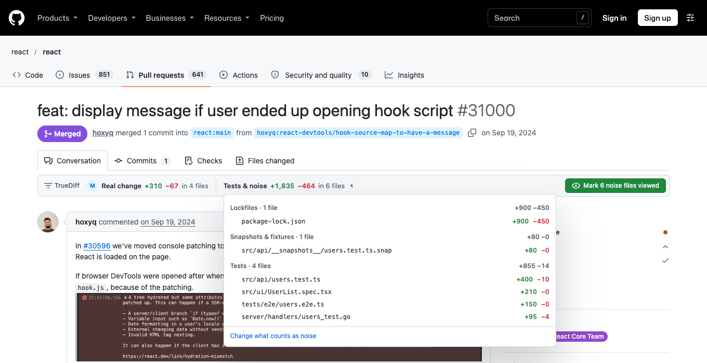
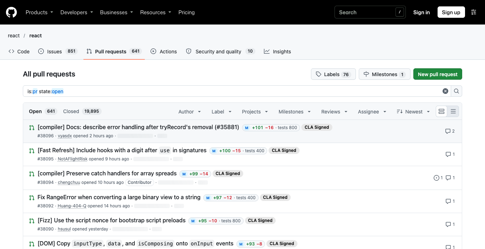

# TrueDiff

**The real size of a GitHub pull request, without the tests.**

A PR that says *29 files, +2,055* often has 17 files and +407 lines of code you actually review. The rest is
tests. TrueDiff shows the real number on the PR page and in PR lists, and marks the test files as viewed in
one click so you're left with only the code that matters.



## What it does

| Where | What you get |
| --- | --- |
| **Every PR page** (all tabs) | A strip under the tabs: **Real change** (size label, `+/−`, files) next to **Tests & noise**. Click the noise to see exactly which files were left out. |
| **"Mark N noise files viewed"** | Marks every noise file viewed on GitHub (it's GitHub's own "Viewed" state, so it syncs everywhere). Files that changed since you viewed them get re-marked. On "Files changed" the page reloads so they collapse. |
| **Auto-mark** (opt-in) | Does the above automatically when you open "Files changed". Skips your own PRs, and runs once per push, so a test file you unmark to read stays unmarked. |
| **PR lists** | A real-size badge next to every PR on repo PR lists, your review-requests dashboard and PR search, so you can pick what to review without opening it. |



Size labels use the real changed lines (additions + deletions): **XS** ≤ 10, **S** ≤ 100, **M** ≤ 400, **L** ≤ 1,000, **XL** above.

## What counts as noise

Each category is a checkbox in settings:

| Category | Default | Examples |
| --- | --- | --- |
| Tests | on | `tests/`, `__tests__/`, `*.test.*`, `*.spec.ts`, `test_*.py`, `*_test.go`, `e2e/`, `cypress/`, `conftest.py`, `jest.config.*` |
| Lockfiles | on | `package-lock.json`, `yarn.lock`, `pnpm-lock.yaml`, `bun.lock`, `poetry.lock`, `uv.lock`, `go.sum` |
| Snapshots & fixtures | on | `__snapshots__/`, `*.snap`, `fixtures/`, `__fixtures__/`, `__mocks__/` |
| Generated / build output | on | `*.min.js`, `*.js.map`, `*.gen.ts`, `*_pb2.py`, `dist/`, `generated/` |
| Database migrations | **off** | `migrations/`, `alembic/versions/`, `db/migrate/` (often worth a look, so off by default) |

You can also add your own patterns, and an **Always review** list that wins over everything (gitignore-style
globs; the settings page explains the syntax and has a box to try a path).

The defaults deliberately avoid loose matches like `*test*`, so product code such as `contests/`, `latest.ts`,
`test-cases.js` or `test-day.tsx` still counts as real change. What can slip through is product code that happens to
follow a test naming rule, such as a `grading/test_case_validation.py` (it matches the pytest rule `test_*.py`).
Add files like that to **Always review**.

## Install

### From a release zip (for reviewers)

1. Download `truediff-<version>.zip` from the [latest release](https://github.com/DipeshRajoria007/truediff/releases/latest) and unzip it somewhere permanent (Chrome loads it from that folder).
2. Open `chrome://extensions`, turn on **Developer mode** (top right), click **Load unpacked** and pick the unzipped folder.
3. The settings page opens. Add a token (below) and open any PR.

Built for Chrome 110+. Other Chromium browsers (Edge, Brave, Arc) should work the same way but haven't been tried yet.

### Create a token

TrueDiff talks to the GitHub API with your own token. Make one just for TrueDiff, as narrow as possible, with an expiry:

- **Fine-grained token (recommended):** [create one](https://github.com/settings/personal-access-tokens/new?name=TrueDiff&description=PR%20review%20helper%20(TrueDiff)&expires_in=90&pull_requests=write)
  (the link pre-fills a 90-day expiry and **Pull requests: Read and write**). Set the resource owner to the org and
  pick the repos you review. The org may need to approve it; until then it can only read public repos.
  Not yet tried end to end: if it can count but not mark, the PR strip shows GitHub's error, and the classic token below works.
- **Classic token:** [create one](https://github.com/settings/tokens/new?scopes=repo&description=TrueDiff%20(PR%20review%20helper))
  with only the `repo` scope and an expiry. `repo` is broad (it could push code), so don't reuse a token you have for
  other tools; the settings page warns if your token has more scopes than TrueDiff needs. If the org uses SSO,
  click **Configure SSO → Authorize** next to the org on the tokens page.

## Rolling it out to the team

- **Easiest today:** point people at the [release zip](https://github.com/DipeshRajoria007/truediff/releases/latest)
  (or run `npm run zip` and share your own build). Everyone loads it unpacked. Downside: no auto-updates, and Chrome shows a "developer mode extensions" notice.
- **Better:** publish it on the Chrome Web Store as a **Private** item visible only to your Google
  Workspace domain. People install it like any extension and get updates automatically.
  It needs a one-time Chrome Web Store developer registration and a store review.

## Security & privacy

- **Permissions:** `storage` (settings + token) and host access to `api.github.com`. The content script runs on `github.com`.
- **The token stays out of github.com.** It lives in `chrome.storage.local`, which TrueDiff locks to its own
  background worker and settings page (`setAccessLevel: TRUSTED_CONTEXTS`). The script that runs inside GitHub tabs
  can't read it and only ever learns "a token is saved: yes/no". The settings page never shows it again after saving
  (only the last 4 characters). It's stored unencrypted in your Chrome profile like all extension data, so anything that
  can read your Chrome profile files could read it: another reason to use a narrow, expiring token.
- **The token only goes to `api.github.com`,** hard-coded, with redirects refused (so it can't be forwarded elsewhere),
  no cookies and no caching.
- **What it can change on GitHub:** only the "Viewed" tick on files (`markFileAsViewed` / `unmarkFileAsViewed`). It never
  comments, approves, merges or pushes.
- **Only TrueDiff can drive TrueDiff.** The background worker accepts messages only from its own settings page and its
  own script on `https://github.com`, checks every field, and the GitHub side can't ask it to test tokens. The
  "Mark" and "Unmark" buttons ignore clicks that a page script fakes; they need a real click or key press.
- **No HTML from data.** File paths, error messages and everything else are inserted as text, never as HTML. The only
  link built from an API response (GitHub's SSO "authorize" link) must be an `https://github.com` URL.
- No analytics, no third-party servers, no remote code. Runtime code has no npm dependencies (only build tools do,
  and `npm audit` is clean).
- `npm test` and `npm run e2e` include checks for all of the above (e.g. the e2e run tries to read the token from
  inside the GitHub tab and to fake clicks on "Mark").

One thing to keep in mind as a team: whatever counts as noise gets less attention, and some "noise" still runs. Test
config such as `conftest.py` or `jest.config.*` runs in CI, and a lockfile change can swap a dependency. If that matters
for a repo, add those paths to **Always review** (e.g. `package-lock.json`, `conftest.py`).

## Development

```sh
npm install
npm run build        # -> dist/ (load this folder unpacked)
npm run watch        # rebuild on change; then hit reload in chrome://extensions
npm test             # unit tests (patterns, counting, API client with a fake GitHub)
npm run typecheck
npm run e2e          # loads dist/ in a throwaway Chromium, real github.com pages, mocked API
                     # (first time: npx playwright install chromium)
npm run smoke -- owner/repo#123   # live API check using your gh CLI token (needs bun;
                     # read-only unless you add --roundtrip, which marks then unmarks one test file)
npm run zip          # build + pack truediff-<version>.zip
```

Layout:

```
src/background/   service worker: GitHub GraphQL client, small cache, message handling
src/content/      runs on github.com: PR strip (pr-page.ts), list badges, router for GitHub's SPA navigation
src/options/      settings page logic (HTML/CSS in public/)
src/shared/       glob matcher, noise categories, settings, summary math, URL parsing
```

**When GitHub changes its HTML:** the strip anchors under `nav[aria-label="Pull request navigation"]` (new UI)
or `nav[aria-label="Pull request tabs"]` (classic files view); if neither exists it floats in the bottom-right
corner instead of disappearing. List badges key off `a[data-testid="listitem-title-link"]` and
`.search-title a`. `npm run e2e` checks all of these against live GitHub.

## Roadmap

**v0.2: make it a team tool**
- Shared per-repo config (e.g. `.github/truediff.yml`) so a repo can declare its own noise patterns for everyone.
- "Hide instead of mark": collapse noise in the file tree without touching viewed state.
- Chrome Web Store private listing for the org (auto-updates).

**Later**
- Sort or filter PR lists by real size; a "smallest first" review queue.
- "Look here first": flag risky real files (migrations, settings, auth, payments) at the top of the strip.
- Respect `linguist-generated` in `.gitattributes` for generated files.
- Firefox build.
- GitHub OAuth (device flow) instead of personal tokens, once the org is happy to approve an OAuth app.

## License

[MIT](LICENSE)
